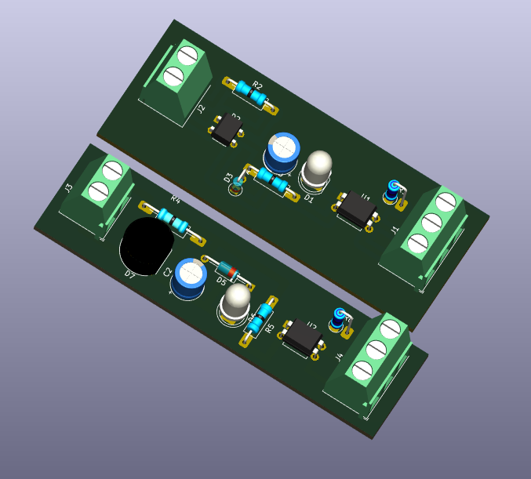

# ZV_Basis_Schaltungen

## 🚀 Basisschaltungen – Optokoppler und Pegelkonverter



 

Hardware-Bausteine für eigene Platinen, ergänzt um einen kleinen ESP8266-Eingangstest. Dieses Repository ist eine Schaltungssammlung und keine MQTT-Gerätesoftware.

**Dokumentationsstand:** 21.10.2026 · Branch `master`. Beschreibt den vorhandenen Projektstand; kein neuer Funktionstest am Gerät.

[Quellcode herunterladen](https://github.com/TimiWho/ZV_Basis_Schaltungen/archive/refs/heads/master.zip)

---

## 📂 Projektstruktur

| Pfad | Inhalt |
| --- | --- |
| [Fritzing/](Fritzing/) | Verdrahtung und Projektunterlagen. |
| [KiCad/](KiCad/) | Schaltplan und Leiterplattenprojekt. |
| [Software/](Software/) | Firmware, Hilfssketches oder Integrationsdateien. |
| [cad_cnc/](cad_cnc/) | Mechanik, Gehäuse- und CNC-Dateien. |
| [docs/](docs/) | Datenblätter, Bilder und ergänzende Projektnotizen. |

## 🔌 Softwaretest und Hardwarevarianten

`Software/Input/Input.ino` definiert `buttonPin=D1` als digitalen Eingang und `ledPin=D4` als Ausgang. Der Loop liest den Eingang mit `digitalRead()` und setzt die LED entsprechend; die genaue Pegelwirkung ergibt sich aus dem Sketch. Es gibt keine MQTT-/HTTP-API und keine Watchdog- oder OTA-Einbindung.

`KiCad/Optokoppler_TTL_240VAC/` und `KiCad/Pegelkonverter/` enthalten getrennte Hardwarevarianten mit eigenen READMEs. Eingangspegel, Versorgung und Klemmenbezeichnungen ergeben sich aus dem jeweiligen Schaltplan, nicht aus dem D1/D4-Testsketch.


## 🐞 GitHub-Issues

**Abgleich:** 21.10.2026. Status aus GitHub; diese Übersicht ändert keine Issues.

Zum Abgleichzeitpunkt sind keine offenen GitHub-Issues vorhanden.

In diesem Repository sind zum Abgleichzeitpunkt keine GitHub-Issues vorhanden.

## 🗂️ Frühere Projektnotizen und Versionshistorie

Die folgenden Angaben stammen aus der bisherigen README. Versionsstände und frühere Integrationsbeispiele sind historisch; die aktuelle Schnittstelle und Belegung stehen oben. Offene Punkte behalten ihren bisherigen Status.

<details>
<summary>Bisherige Projektnotizen anzeigen</summary>

## V0.1 / 250228
- [ ] Basis Schaltungen wie ich sie auf meinen Platinen verwende

# Lizenz und Haftungsausschluss

Dieses Hardware-Design wird unter der CERN Open Hardware Licence Version 2 (CERN-OHL-P-2.0) veröffentlicht. Das bedeutet:

Jeder darf dieses Design frei nutzen, ändern und weitergeben.
Änderungen müssen ebenfalls unter der CERN-OHL veröffentlicht werden.
Eine Kopie der Lizenz muss beigefügt werden.
Die vollständigen Lizenzbedingungen sind hier zu finden:
CERN-OHL-P-2.0

Haftungsausschluss:
Dieses Design wird ohne jegliche Gewährleistung bereitgestellt. Es wird ohne Mängelgewähr veröffentlicht, ohne Garantie auf Funktionalität, Sicherheit oder Eignung für einen bestimmten Zweck. Die Nutzung erfolgt auf eigene Gefahr. Der Autor übernimmt keine Haftung für Schäden, die durch die Nutzung entstehen.

Durch die Verwendung dieses Designs erklärst du dich mit diesen Bedingungen einverstanden.

[TimiWho](https://timi.at/)


```
TTL AC 220V Isolation Modul SCM Test Board
```

</details>
